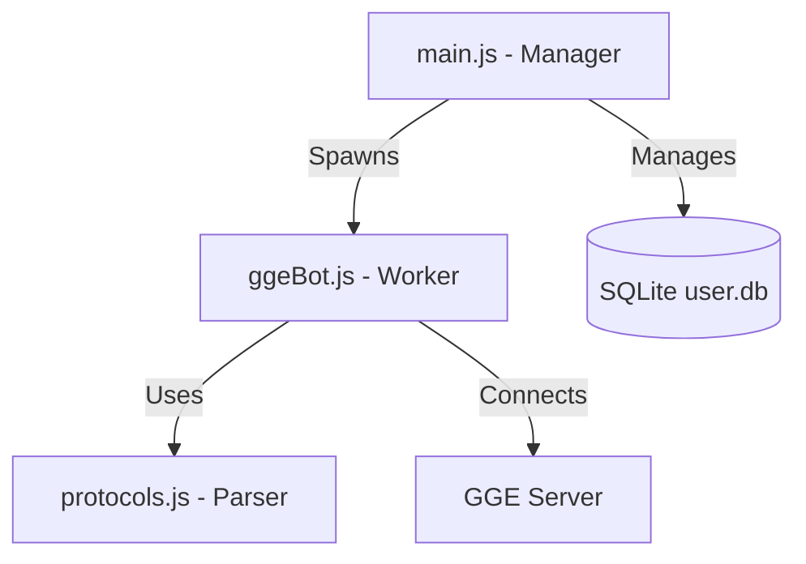

# BOT-Engine (Core)


## Project Overview
This is the **Core Engine** of the BOT-Engine project, stripped down to its essential components. It is designed as a lightweight, high-performance base for building custom Goodgame Empire (GGE) tools such as account checkers, lead generators, or automated managers.

### Core Components Preserved:
- **`main.js`**: The central engine manager and API server.
- **`ggeBot.js`**: The worker thread implementation for isolated bot logic.
- **`protocols.js`**: The comprehensive GGE `%xt%` protocol parser.
- **`user.db`**: Automatic SQLite database creation and management for users and sessions.
- **Auto-Asset Sync**: Automatic downloading of the latest game items, languages, and server configs from GGE CDN.

## Architecture


## Getting Started
1. **Install Dependencies**:
   ```bash
   npm install
   ```
2. **Configuration**:
   Modify `ggeConfig.json` (auto-generated on first run) with your specific settings.
3. **Run**:
   ```bash
   node main.js
   ```

## Support
If this project saved you some time and you want to contribute back, crypto donations are welcome:

**USDT (BEP20)**  
`0x03544B54fAc69a1616618aABDBBe31cBDe650ED1`

**Bitcoin**  
`bc1ql5nlel7n96ax40ve7sg84ddqp9ha3c4jmmv9nv`

**ETH**  
`0x03544B54fAc69a1616618aABDBBe31cBDe650ED1`

**Solana**  
`GkybF55ShiLanp3sZ6w9h1u9ycQiGX7BJs7eMLLro6de`

**Tron**  
`TKx9pn6eGFEEMUhr1Br5cHqHh7age4nBKU`

**BNB**  
`0x03544B54fAc69a1616618aABDBBe31cCDe650ED1`
